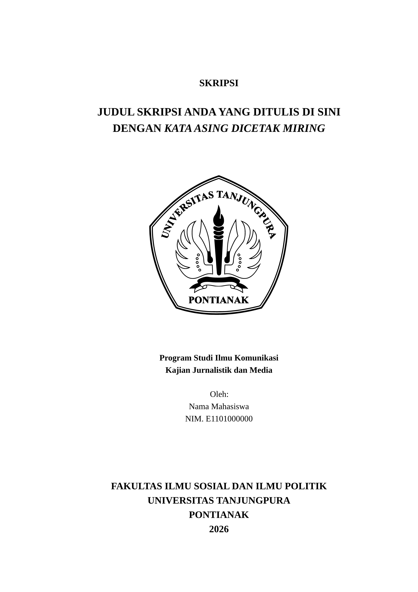

# Template Skripsi FISIP UNTAN (Typst)

Template Typst untuk skripsi Fakultas Ilmu Sosial dan Ilmu Politik (FISIP) Universitas Tanjungpura, mengikuti *Panduan Penulisan Skripsi FISIP UNTAN*.



> **Status: belum terbit di Typst Universe.** Selama belum rilis, template dipasang dari repositori ini seperti dijelaskan di bawah. Perintah `typst init @preview/...` tetap bisa dipakai, tetapi paketnya harus dipasang dulu ke komputer Anda. Setelah terbit, cara singkatnya ada di [Setelah terbit di Typst Universe](#setelah-terbit-di-typst-universe).

## Pilih template

Template tersedia dalam dua versi dengan kode yang sama. Bedanya hanya kerangka BAB di `main.typ`, jadi pilih sesuai metode penelitian Anda:

| Paket | Untuk |
| --- | --- |
| `skripsi-fisip-untan-kuantitatif` | Penelitian kuantitatif |
| `skripsi-fisip-untan-kualitatif` | Penelitian kualitatif |

## Yang perlu disiapkan

1. **Typst** versi 0.14 atau lebih baru. Unduh dari [halaman rilis Typst](https://github.com/typst/typst/releases), atau ikuti [panduan instalasi resmi](https://typst.app/installation). Cek dengan:

   ```sh
   typst --version
   ```

2. **Git** (opsional). Jika tidak ada Git, repositori tetap bisa diunduh sebagai ZIP.
3. **Font Liberation Serif** (disarankan). Tanpa font ini dokumen tetap bisa dibuat, tetapi Typst memakai font pengganti dan memberi peringatan. Lihat [Font](#font).

## Cara 1: Pasang sekali, lalu buat proyek (disarankan)

Cara ini membuat folder skripsi yang bersih dan terpisah dari repositori template. Perintah di bawah dijalankan di terminal Linux, macOS, atau WSL/Git Bash di Windows. Jika tidak ingin memakai terminal, gunakan Cara 2.

### 1. Unduh repositori

```sh
git clone https://github.com/bintangazhar/template-skripsi-fisip-untan.git
cd template-skripsi-fisip-untan
```

Kalau gak punya Git: buka halaman repositori, klik **Code → Download ZIP**, ekstrak, lalu masuk ke folder hasil ekstrak.

### 2. Pasang template ke Typst

```sh
scripts/build.sh install
```

Perintah ini bakal masang kedua paket lalu menautkannya ke cache Typst. Keluarannya kurang lebih:

```text
build: skripsi-fisip-untan-kuantitatif 0.1.0 -> dist/preview/skripsi-fisip-untan-kuantitatif/0.1.0
build: skripsi-fisip-untan-kualitatif 0.1.0 -> dist/preview/skripsi-fisip-untan-kualitatif/0.1.0
install: /home/nama/.cache/typst/packages/preview/skripsi-fisip-untan-kuantitatif/0.1.0
install: /home/nama/.cache/typst/packages/preview/skripsi-fisip-untan-kualitatif/0.1.0
```

> Jangan memindahkan atau menghapus folder repositori yang didownload selama memakai cara ini, karena paket yang terpasang menaut (symlink) ke folder tersebut. Jika folder dipindah, jalankan `scripts/build.sh install` lagi dari lokasi baru di dalam folder `template-skripsi-fisip-untan`.

### 3. Buat folder baru untuk ngerjakan skripsinya

```sh
typst init @preview/skripsi-fisip-untan-kuantitatif:0.1.0 skripsi-saya
cd skripsi-saya
```

Ganti `kuantitatif` menjadi `kualitatif` jika penelitian Anda kualitatif. Ganti `skripsi-saya` dengan nama folder yang Anda inginkan.

Typst akan membuat proyek berisi:

```text
skripsi-saya/
├── main.typ     isi skripsi Anda
└── refs.bib     daftar referensi
```

### 4. Compile dan lihat hasilnya

```sh
typst watch main.typ
```

Perintah ini membuat `main.pdf` dan otomatis memperbarui PDF setiap kali `main.typ` disimpan. Buka `main.pdf` dengan pembaca PDF yang bisa memuat ulang otomatis. Tekan `Ctrl+C` untuk berhenti.

Jika hanya ingin sekali compile:

```sh
typst compile main.typ
```

### 5. Mulai menulis

Buka `main.typ`. Data diri, dosen, dan jadwal ujian ada di bagian paling atas; isi bagian itu lebih dulu. Setelah itu tulis isi setiap BAB. Penjelasan lengkapnya ada di [sini](#cara-pakai-ini-barang).

## Cara 2: Tanpa memasang paket (manual atau Typst web app)

Cara ini tidak mengubah cache Typst. Cocok kalau Anda ingin langsung memakai berkas template, atau memakai **Typst web app** yang tidak bisa membaca cache lokal.

### A. Di komputer

1. Unduh dan ekstrak repositori seperti pada Cara 1.
2. Salin template dan kode pendukungnya ke folder skripsi baru:

   ```sh
   cp -R template-skripsi-fisip-untan/packages/kuantitatif/template skripsi-saya
   cp -R template-skripsi-fisip-untan/src skripsi-saya/src
   cd skripsi-saya
   ```

   Untuk penelitian kualitatif, ganti `kuantitatif` menjadi `kualitatif`.

3. Buka `main.typ` dan ubah baris pertama:

   ```typ
   // sebelum
   #import "@preview/skripsi-fisip-untan-kuantitatif:0.1.0": *

   // sesudah
   #import "src/lib.typ": *
   ```

4. Compile seperti biasa:

   ```sh
   typst watch main.typ
   ```

### B. Di Typst web app

1. Unduh dan ekstrak repositori.
2. Buka <https://typst.app>, lalu buat project baru yang kosong (**New project**, pilih opsi project kosong).
3. Unggah `main.typ` dan `refs.bib` dari folder `packages/kuantitatif/template/` ke project.
4. Unggah folder `src` (berisi `lib.typ` dan folder `img/`) ke project. Jika folder tidak bisa diunggah langsung, buat folder `src`, lalu unggah `lib.typ` dan isi `src/img/` ke dalamnya.
5. Ubah baris pertama `main.typ` menjadi:

   ```typ
   #import "src/lib.typ": *
   ```

6. Klik **Compile**. Liberation Serif sudah tersedia di Typst web app, jadi tampilan font langsung sesuai panduan.

## Cara pakai ini barang

### Struktur file

```text
main.typ     seluruh isi skripsi: data, bagian awal, BAB, daftar pustaka, lampiran
refs.bib     daftar referensi (BibTeX)
src/         kode template dan logo (hanya ada di Cara 2; jangan diubah)
```

Data skripsi ditulis sebagai variabel di bagian atas `main.typ`:

```typ
#let judul = [Judul Skripsi Anda]
#let nama = "Nama Mahasiswa"
#let nim = "E1101000000"
#let prodi = "Ilmu Komunikasi"
#let kajian = "Jurnalistik dan Media"
#let tahun = "2026"
#let pembimbing-1 = (nama: "Nama Pembimbing Utama, M.Si", nip: "19700101 200001 1 001")
#let pembimbing-2 = (nama: "Nama Pembimbing Pendamping, M.Si", nip: "19750101 200001 1 002")
#let penguji-1 = (nama: "Dr. Nama Penguji Utama, M.Si", nip: "19650302 199002 2 001")
#let penguji-2 = (nama: "Dr. Nama Penguji Pendamping, M.Si", nip: "19740810 200212 2 002")
#let dekan = (nama: "Nama Dekan, S.Sos., M.Si.", nip: "19720521 200604 1 001")
#let hari-tanggal-ujian = "Kamis / 09 Juli 2026"
#let waktu-ujian = "09.00 - 12.00 WIB"
#let tempat-ujian = "Ruang Sidang 6"
```

Variabel itu otomatis dipakai di Sampul, Lembar Persetujuan, Halaman Pengesahan, Pernyataan Keaslian, dan Kata Pengantar.

Setelah data, urutannya sudah disiapkan: Abstrak, Ringkasan, Pernyataan Keaslian, Motto dan Persembahan, Kata Pengantar, Daftar Isi, lalu BAB I sampai VI. Ganti teks contoh dengan tulisan Anda. Setiap `= BAB ...` otomatis mulai di halaman baru, dan nomor tabel/gambar mengikuti nomor BAB.

### Mengutip dan daftar pustaka

Tambahkan referensi ke `refs.bib` (BibTeX) atau berkas Hayagriva `.yml`, lalu kutip dengan `@kunci`:

| Penulisan | Hasil |
| --- | --- |
| `#cite("silalahi2009")[23-24]` | Silalahi (2009, 23-24) |
| `#cite("silalahi2009")` | Silalahi (2009) |
| `#cite-dalam([Bintang], "silalahi2009")[23]` | Bintang (dalam Silalahi 2009, 23) |
| `#cite-dalam-kurung([Bintang], "silalahi2009")[23]` | (Bintang dalam Silalahi 2009, 23) |
| `@silalahi2009[35-36]` | (Silalahi 2009, 35-36) |
| `@ward2007[52]` | (Ward dan Burns 2007, 52) |
| `@ward2012[76-81]` | (Ward dkk. 2012, 76-81) |

`#cite("kunci")[halaman]` adalah versi ringkas dari `#cite(<kunci>, form: "prose", supplement: [halaman])` untuk nama penulis di awal kalimat. `#cite-dalam(..)` dipakai untuk kutipan tidak langsung di awal kalimat; `#cite-dalam-kurung(..)` untuk yang di akhir kalimat.

Gaya Chicago bawaan Typst tidak menampilkan kolom `address`. Agar tampil sebagai "Bandung: Refika Aditama" seperti di panduan FISIP, tulis kota dan penerbit sekaligus di kolom `publisher`:

```bib
@book{silalahi2009,
  author    = {Silalahi, Ulber},
  year      = {2009},
  title     = {Metode Penelitian Sosial},
  publisher = {Bandung: Refika Aditama},
}
```

Hanya sumber yang dikutip yang masuk daftar pustaka. Untuk memunculkan sumber yang tidak dikutip, tambahkan `#cite(<kunci>, form: none)`.

### Tabel dan gambar

Judul di atas, sumber di bawah (rata kiri). Nomor otomatis mengikuti BAB.

```typ
#figure(
  kind: table,
  caption: [Distribusi Responden],
  [
    #table(columns: 2, [A], [B])
    #sumber[Data primer, diolah penulis (2026)]
  ],
) <tbl-responden>
```

Rujuk dengan `@tbl-responden`. Untuk gambar, gunakan `kind: image` dan ganti isi `figure` dengan `image("gambar.png")`.

### Lampiran

Satu lampiran ditulis dengan `#lampiran[judul][isi]`. Nomornya otomatis, selalu mulai di halaman baru setelah Daftar Pustaka, dan masuk ke Daftar Lampiran. Hapus bagian lampiran di `main.typ` jika tidak diperlukan.

## Font

Font isi adalah **Liberation Serif**, padanan Times New Roman, ukuran 12 pt.

- **Typst web app:** font sudah tersedia, tidak perlu memasang apa pun.
- **Linux (Debian/Ubuntu):** `sudo apt install fonts-liberation`
- **Linux (Fedora):** `sudo dnf install liberation-fonts`
- **Linux (Arch):** `sudo pacman -S ttf-liberation`
- **macOS / Windows:** unduh dari [Liberation Serif](https://www.dafont.com/liberation-serif.font), lalu pasang seperti font biasa.

Alternatif tanpa memasang font ke sistem: letakkan berkas font di folder `fonts/`, lalu compile dengan:

```sh
typst compile --font-path fonts main.typ
```

Tanpa font ini, Typst memberi peringatan dan memakai Libertinus Serif bawaannya. Dokumen tetap bisa dicetak, tetapi ukuran dan bentuk hurufnya tidak persis Times New Roman.

Typst Universe tidak mengizinkan paket membawa file font, jadi template tidak membundelnya.

## Memperbarui template

**Cara 1:**

```sh
cd template-skripsi-fisip-untan
git pull
scripts/build.sh install
```

Project yang sudah ada otomatis memakai kode terbaru selama nomor versinya sama. Jika versi template naik (misalnya `0.2.0`), ubah nomor versi pada baris `#import` di `main.typ`, atau buat folder skripsi baru dengan `typst init` memakai versi terbaru.

**Cara 2:** salin ulang folder `src` dari repositori terbaru ke proyek Anda. Jangan menimpa `main.typ` dan `refs.bib`, karena itu berisi tulisan Anda.

## Kalau ada masalah

| Gejala | Penyebab dan solusi |
| --- | --- |
| `package not found` atau `unknown package` | Paket belum terpasang. Jalankan `scripts/build.sh install` dari folder repositori, lalu cek nomor versi pada `#import` sama dengan yang terpasang. |
| `file not found` saat compile (Cara 2) | Folder `src` belum ada di dalam proyek, atau baris pertama `main.typ` belum diubah menjadi `#import "src/lib.typ": *`. |
| Peringatan `unknown font family: liberation serif` | Font Liberation Serif belum terpasang. Lihat [Font](#font); dokumen tetap bisa dicetak dengan font pengganti. |
| `file not found: img/logo-untan.svg` | Folder `src/img/` tidak ikut tersalin. Salin ulang folder `src` secara utuh. |
| `typst: command not found` | Typst belum terpasang atau belum ada di `PATH`. Lihat [Yang perlu disiapkan](#yang-perlu-disiapkan). |
| `Permission denied` saat menjalankan script | Jalankan dengan `bash scripts/build.sh install`. |
| Paket tidak ditemukan di macOS setelah `install` | Script memasang ke `~/Library/Caches/typst/packages/preview`. Pastikan Anda memakai versi script terbaru dari repositori ini. |

## Setelah terbit di Typst Universe

Setelah paket disetujui dan terbit, cara tercepat menjadi:

```sh
typst init @preview/skripsi-fisip-untan-kuantitatif:0.1.0
typst init @preview/skripsi-fisip-untan-kualitatif:0.1.0
```

Di Typst web app, paket bisa dicari lewat **Start from template** tanpa perlu mengunggah berkas manual. Sampai saat itu, gunakan Cara 1 atau Cara 2 di atas.

## Struktur dokumen

Dokumen tersusun dalam urutan berikut:

1. Sampul Luar, dari `skripsi(..)`
2. Lembar Persetujuan Pembimbing, dari `skripsi(..)`
3. Halaman Pengesahan, dari `skripsi(..)`
4. Bagian awal, bernomor romawi: Abstrak, Ringkasan Skripsi, Pernyataan Keaslian, Motto dan Persembahan, Kata Pengantar
5. Daftar Isi, lalu Daftar Tabel, Daftar Gambar, dan Daftar Lampiran jika dokumen memilikinya
6. BAB I sampai VI, nomor halaman mulai dari 1, dari `#show: bagian-inti` dan `= BAB ...`
7. Daftar Pustaka, dari `daftar-pustaka(..)`
8. Lampiran, dari `lampiran[..][..]`

Tata letak halaman mengikuti panduan fakultas dan tidak punya opsi: A4, margin kiri dan atas 4 cm, kanan dan bawah 3 cm, spasi 1,5.

## Konfigurasi

Template mengekspor fungsi `skripsi` dengan argumen bernama di bawah. Fungsi ini juga menerima satu argumen posisional, yaitu isi dokumen, yang diteruskan otomatis oleh `#show: skripsi.with(..)`.

### Data mahasiswa

- `judul`\
  type: [content] or [str]\
  default: `[Judul Skripsi]`\
  description: Judul skripsi, tampil di Sampul, Lembar Persetujuan, dan Halaman Pengesahan. Kata asing bisa dicetak miring dengan `_..._`.

- `nama`\
  type: [str]\
  default: `"Nama Mahasiswa"`\
  description: Nama mahasiswa.

- `nim`\
  type: [str]\
  default: `"E1101000000"`\
  description: NIM, ditulis "NIM. ..." di setiap halaman yang memuatnya.

- `prodi`\
  type: [str]\
  default: `"Ilmu Komunikasi"`\
  description: Ditulis "Program Studi .." di Sampul.

- `kajian`\
  type: [str]\
  default: `"Jurnalistik dan Media"`\
  description: Ditulis "Kajian .." di Sampul.

- `fakultas`\
  type: [str]\
  default: `"Fakultas Ilmu Sosial dan Ilmu Politik"`\
  description: Bagian bawah Sampul.

- `universitas`\
  type: [str]\
  default: `"Universitas Tanjungpura"`\
  description: Bagian bawah Sampul.

- `kota`\
  type: [str]\
  default: `"Pontianak"`\
  description: Bagian bawah Sampul.

- `tahun`\
  type: [str]\
  default: tahun berjalan\
  description: Bagian bawah Sampul.

### Dosen

Setiap argumen di bagian ini berupa dictionary `(nama: "..", nip: "..")`.

- `pembimbing-1`, `pembimbing-2`\
  type: [dictionary]\
  default: `(nama: "Nama Pembimbing .., M.Si", nip: "00000000 000000 0 000")`\
  description: Pembimbing Utama dan Pembimbing Pendamping. Keduanya menandatangani Lembar Persetujuan. Di Halaman Pengesahan keduanya menjadi Ketua dan Sekretaris.

- `penguji-1`, `penguji-2`\
  type: [dictionary]\
  default: `(nama: "Dr. Nama Penguji .., M.Si", nip: "00000000 000000 0 000")`\
  description: Penguji Utama dan Penguji Pendamping di Halaman Pengesahan.

- `dekan`\
  type: [dictionary]\
  default: `(nama: "Nama Dekan", nip: "00000000 000000 0 000")`\
  description: Dekan, yang mengesahkan di Halaman Pengesahan.

### Jadwal ujian

- `hari-tanggal-ujian`\
  type: [str]\
  default: `"Hari / 00 Bulan 0000"`\
  description: Hari dan tanggal ujian, e.g. `"Kamis / 09 Juli 2026"`.

- `waktu-ujian`\
  type: [str]\
  default: `"00.00 - 00.00 WIB"`\
  description: Waktu ujian.

- `tempat-ujian`\
  type: [str]\
  default: `"Ruang Sidang"`\
  description: Tempat ujian.

### Opsi tampilan halaman

- `tampilkan-sampul`\
  type: [bool]\
  default: `true`\
  description: Tampilkan Sampul Luar dan Sampul Dalam. Set `false` untuk sembunyikan keduanya.

- `tampilkan-persetujuan`\
  type: [bool]\
  default: `true`\
  description: Tampilkan Lembar Persetujuan Pembimbing. Set `false` untuk sembunyikan.

- `tampilkan-pengesahan`\
  type: [bool]\
  default: `true`\
  description: Tampilkan Halaman Pengesahan. Set `false` untuk sembunyikan.

## Fungsi

- `abstrak(kata-kunci: none, body)`\
  description: Halaman Abstrak. `kata-kunci` ditulis di bawah isi abstrak.

- `pernyataan-keaslian()`\
  description: Halaman Pernyataan Keaslian, diisi otomatis dari data `skripsi(..)`.

- `daftar-isi()`\
  description: Daftar Isi, serta Daftar Tabel, Daftar Gambar, dan Daftar Lampiran jika dokumen memilikinya.

- `bagian-inti`\
  description: Dipakai dengan `#show: bagian-inti`. Mengatur penomoran halaman, nomor subbab, serta nomor tabel dan gambar per BAB. Setiap `= BAB ...` mulai di halaman baru.

- `sumber[..]`\
  description: Baris "Sumber:" rata kiri di bawah tabel atau gambar. Dipakai di dalam `figure`.

- `daftar-pustaka(bib)`\
  description: Halaman Daftar Pustaka. Argumennya `bibliography("refs.bib")`.

- `lampiran[judul][isi]`\
  description: Satu Lampiran, bernomor "LAMPIRAN 1, 2, ..." otomatis. Mulai di halaman baru tepat setelah Daftar Pustaka dan masuk ke Daftar Lampiran.

- `cite("kunci")[halaman]`\
  description: Kutipan dengan nama penulis di awal kalimat, e.g. "Silalahi (2009, 23-24)". Versi ringkas dari `cite(<kunci>, form: "prose", supplement: [halaman])`.

- `cite-dalam(nama, "kunci")[halaman]`\
  description: Kutipan tidak langsung di awal kalimat, e.g. "Bintang (dalam Silalahi 2009, 23)".

- `cite-dalam-kurung(nama, "kunci")[halaman]`\
  description: Kutipan tidak langsung di akhir kalimat, e.g. "(Bintang dalam Silalahi 2009, 23)".

## Pengembangan

Kode ada di `src/` dan disalin ke kedua paket oleh `scripts/build.sh`, jadi edit sekali saja.

```text
src/                    kode bersama: lib.typ dan logo
docs/penggunaan.md      bagian README bersama untuk kedua paket
packages/
  kuantitatif/          typst.toml, README.md, thumbnail.png, template/
  kualitatif/           typst.toml, README.md, thumbnail.png, template/
scripts/build.sh        package builder
LICENSE
```

README tiap paket di Typst Universe adalah `packages/<jenis>/README.md` ditambah `docs/penggunaan.md`.

```sh
scripts/build.sh build        # rakit paket ke dist/preview/<nama>/<versi>/
scripts/build.sh test         # typst init + compile kedua template (sementara memasang ke cache Typst)
scripts/build.sh thumbnails   # buat ulang packages/*/thumbnail.png
scripts/build.sh install      # pasang paket ke cache Typst agar bisa dicoba lewat `typst init`
scripts/build.sh uninstall    # lepas lagi
```

Untuk mencoba template secara manual, jalankan `install`, lalu `typst init @preview/skripsi-fisip-untan-kuantitatif:0.1.0 coba`. Setelah selesai, jalankan `uninstall`.

## Lisensi

Kode dan file di `template/` berlisensi [MIT-0](LICENSE): pakai tanpa atribusi.

`src/img/logo-untan.svg` dan `src/img/logo-untan.png` adalah *Logo Universitas Tanjungpura (UNTAN)* yang merupakan lambang resmi milik institusi pendidikan tinggi negeri yang dilindungi hak kekayaan intelektual dan pengaturannya berada di bawah kewenangan universitas serta Sentra KI Universitas Tanjungpura. Logo disertakan agar Sampul sesuai panduan resmi fakultas.

[content]: https://typst.app/docs/reference/foundations/content/
[dictionary]: https://typst.app/docs/reference/foundations/dictionary/
[str]: https://typst.app/docs/reference/foundations/str/
